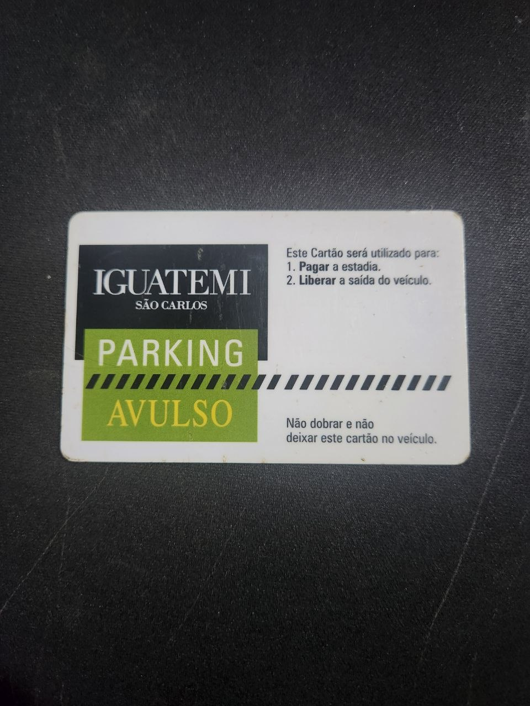
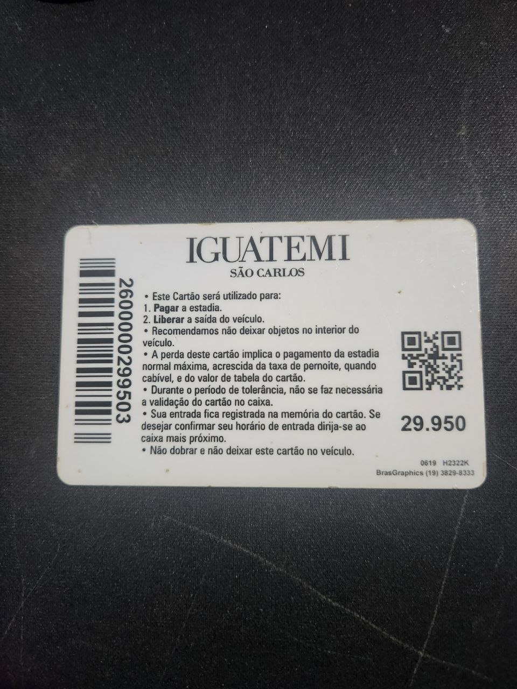

```
[usb] pm3 --> hf mf info

[=] --- ISO14443-a Information -----------------------------
[+]  UID: CE 56 AF 60
[+] ATQA: 00 04
[+]  SAK: 08 [2]

[=] --- Keys Information
[+] loaded 2 user keys
[+] loaded 64 hardcoded keys

[=] --- Fingerprint
[=] <n/a>

[=] --- Magic Tag Information
[=] <n/a>

[=] --- PRNG Information
[#] Static nonce....... 01200145
[+] Static nonce... yes
```



